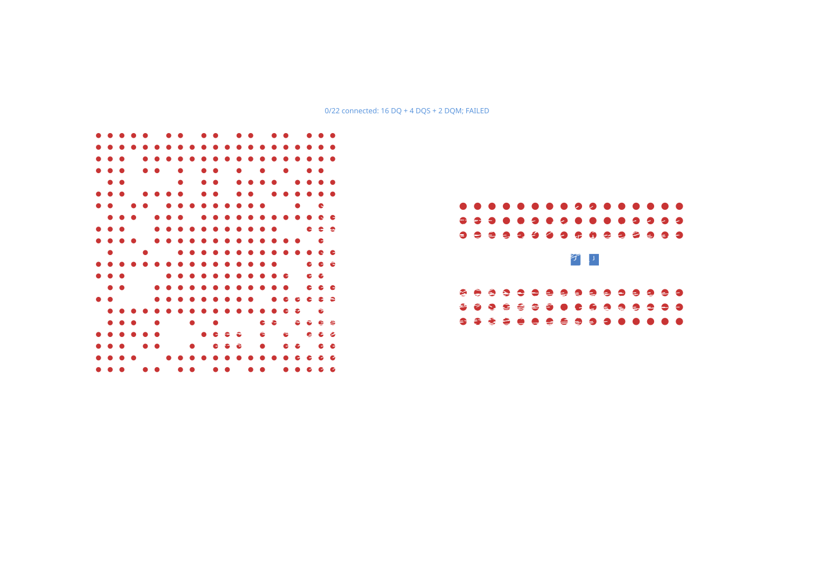

# H3 complete byte groups

Real geometry from [hvwyl/allwinner-h3-ddr3-16x1-kicad](https://github.com/hvwyl/allwinner-h3-ddr3-16x1-kicad/blob/02e365b21363a17710e0f96072c0844940495567/project/allwinner-h3.kicad_pcb), using the repository's unchanged `circuits/h3.json.gz` and native pad renderer.

Request both complete DDR byte groups: 16 DQ, four DQS and two DQM signals. All 445 pads and 53 source traces remain declared. Keep two layers, 0.1143 mm traces, 0.0889 mm clearance, 0.45/0.20 mm vias and no via-in-pad.

`routeByteGroupsTogether` requests simultaneous planning while retaining two separate bus definitions. The original board builder ignores that request and freezes byte zero before routing byte one. Byte one fails, and Core emits 0/22 accepted paths. The stacked fix changes the builder; this board and renderer stay unchanged.



From the repository root:

```sh
bun install
cd repros/h3-byte-groups
bun install --frozen-lockfile
bun run render
```

The renderer uses published tscircuit 0.0.3114 through Core, verifies actual wire/via connectivity and nine physical checks, and writes `result.json` and `board.snap.svg`. Its failed baseline is explicitly labeled. `circuit.json` is a local diagnostic and is not committed.

This is a complete byte-group section, not the full 53-signal interface. It does not establish DDR timing, skew or impedance compliance.
